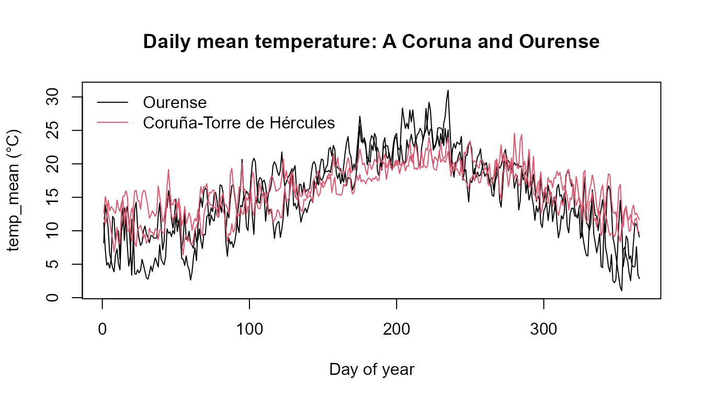

# Functional data analysis with MeteoGalicia

``` r

library(meteogal2fdata)
library(fda.usc)
#> Loading required package: fda
#> Loading required package: splines
#> Loading required package: fds
#> Loading required package: rainbow
#> Loading required package: MASS
#> Warning: package 'MASS' was built under R version 4.6.1
#> Loading required package: pcaPP
#> Loading required package: RCurl
#> Warning: package 'RCurl' was built under R version 4.6.1
#> Loading required package: deSolve
#> 
#> Attaching package: 'fda'
#> The following object is masked from 'package:graphics':
#> 
#>     matplot
#> The following object is masked from 'package:datasets':
#> 
#>     gait
#> Loading required package: mgcv
#> Loading required package: nlme
#> Warning: package 'nlme' was built under R version 4.6.1
#> This is mgcv 1.9-4. For overview type '?mgcv'.
#> Loading required package: knitr
#> Warning: package 'knitr' was built under R version 4.6.1
#>  fda.usc is running sequentially usign foreach package
#>  Please, execute ops.fda.usc() once to run in local parallel mode
#>  Deprecated functions: min.basis, min.np, anova.hetero, anova.onefactor, anova.RPm
#>  New functions: optim.basis, optim.np, fanova.hetero, fanova.onefactor, fanova.RPm
#> ----------------------------------------------------------------------------------
```

## One annual curve per station and year

[`meteogal2fdata()`](https://moviedo5.github.io/meteogal2fdata/reference/meteogal2fdata.md)
converts one numerical variable into an `fdata` object. Each row is one
station-year and the 365 columns represent calendar days on a common
non-leap-year grid. February 29 is removed and subsequent days in leap
years are shifted back, so day 60 is always March 1.

Days without observations and values rejected by the selected validation
criterion remain `NA`; the package does not impute them.

``` r

f <- system.file("extdata", "meteogal_small.csv", package = "meteogal2fdata")
mg <- meteogal2df(data_dir = f)
fd <- meteogal2fdata(df = mg, var = "temp_mean")
dim(fd$data)
#> [1]   1 365
fd$data[1, 1:7]
#>     1     2     3     4     5     6     7 
#> 12.59 15.10 14.04 12.52 11.49  9.90    NA
```

The bundled `meteogal_small.csv` contains only a few days and is
intended to show the representation and missing-day behaviour, not a
complete annual curve.

## Several variables: `ldata`

[`meteogal2lfdata()`](https://moviedo5.github.io/meteogal2fdata/reference/meteogal2lfdata.md)
constructs an
[`fda.usc::ldata`](https://moviedo5.github.io/fda.usc/reference/ldata.html)
object. Its first element, `ld$df`, contains one row per station-year;
each remaining element is an aligned `fdata` object for one variable.

``` r

ld <- meteogal2lfdata(df = mg, vars = c("temp_mean", "prec"))
names(ld)
#> [1] "df"        "temp_mean" "prec"
names(ld$df)
#>  [1] "station_id"          "station_name"        "municipality"       
#>  [4] "province"            "altitude"            "lon"                
#>  [7] "lat"                 "year"                "n_days"             
#> [10] "first_date"          "last_date"           "fecha"              
#> [13] "n_temp_mean_valid"   "n_temp_mean_interp"  "n_temp_mean_masked" 
#> [16] "n_temp_mean_missing" "qc_temp_mean"        "n_prec_valid"       
#> [19] "n_prec_interp"       "n_prec_masked"       "n_prec_missing"     
#> [22] "qc_prec"
identical(rownames(ld$df), rownames(ld$temp_mean$data))
#> [1] TRUE
```

### Metadata and quality information

Important columns of `ld$df` are:

| column | meaning |
|----|----|
| `station_id`, `station_name`, `municipality`, `province`, `altitude`, `lon`, `lat` | station metadata |
| `year`, `n_days` | curve identifier and number of dates with any record |
| `first_date`, `last_date` | first and last record of that station-year |
| `fecha` | 365-column matrix with the original date represented at each grid position |
| `n_<v>_valid` | observations used in variable `<v>` after applying `quality` |
| `n_<v>_interp` | used observations carrying MeteoGalicia code 5 |
| `n_<v>_masked` | observations excluded by `quality` |
| `n_<v>_missing` | missing points on the 365-day grid |
| `qc_<v>` | 365-column matrix of validation codes |

The date and validation-code matrices are columns of `ld$df`, which
keeps them aligned when an `ldata` object is subset.

``` r

ld$df[, c("fecha", "qc_temp_mean")]
#>                                 fecha qc_temp_mean
#> 10157_2024 2024-01-01..2024-01-06 (6)       NA:365
unclass(ld$df$fecha)[1, 1:8]
#>            1            2            3            4            5            6 
#> "2024-01-01" "2024-01-02" "2024-01-03" "2024-01-04" "2024-01-05" "2024-01-06" 
#>            7            8 
#>           NA           NA
```

A small artificial example illustrates the quality metadata:

``` r

toy <- data.frame(
  fecha = as.Date("2024-01-01") + 0:3,
  station_id = "toy",
  temp_mean = c(10, 11, 30, 12),
  qc_temp_mean = c(1L, 5L, 2L, 0L)
)
ld_toy <- meteogal2lfdata(df = toy, vars = "temp_mean")
#> [MeteoGalicia] quality = c(1, 5): values set to NA: 1 with code 0 (Not validated); 1 with code 2 (Suspect). Codes are kept in the qc_ columns; see meteogal_qc_codes().
ld_toy$temp_mean$data[1, 1:5]
#>  1  2  3  4  5 
#> 10 11 NA NA NA
ld_toy$df[, c("n_temp_mean_valid", "n_temp_mean_interp",
              "n_temp_mean_masked", "n_temp_mean_missing", "qc_temp_mean")]
#>          n_temp_mean_valid n_temp_mean_interp n_temp_mean_masked
#> toy_2024                 2                  1                  2
#>          n_temp_mean_missing           qc_temp_mean
#> toy_2024                 363 0:1 1:1 2:1 5:1 NA:361
```

## A real coastal-inland comparison

`data-raw/build-example.R` creates a real 2023-2024 example using
Coruña-Torre de Hércules (`10157`) and Ourense (`10148`). These stations
provide a clearer coastal-inland comparison than two nearby stations in
the same climatic area.

``` r

full <- system.file("extdata", "meteogal_example.csv", package = "meteogal2fdata")
inv_file <- system.file("extdata", "meteogal_example_inventory.rds",
                        package = "meteogal2fdata")
if (nzchar(full)) {
  ldf <- meteogal2lfdata(
    file = full,
    vars = c("temp_mean", "prec"),
    inventory = if (nzchar(inv_file)) inv_file else NULL
  )
  print(ldf$df[, c("station_id", "station_name", "year", "n_days",
                   "n_temp_mean_valid", "n_temp_mean_interp",
                   "n_temp_mean_masked")])

  station_col <- as.integer(factor(ldf$df$station_id))
  plot(ldf$temp_mean, col = station_col,
       main = "Daily mean temperature: A Coruna and Ourense")
  ii <- !duplicated(ldf$df$station_id)
  legend("topleft", legend = ldf$df$station_name[ii],
         col = station_col[ii], lty = 1, bty = "n")
} else {
  cat("Run data-raw/build-example.R to create the real two-station example.\n")
}
#> [MeteoGalicia] quality = c(1, 5): values set to NA: 1 with code 2 (Suspect). Codes are kept in the qc_ columns; see meteogal_qc_codes().
#>            station_id             station_name year n_days n_temp_mean_valid
#> 10148_2023      10148                  Ourense 2023    365               365
#> 10148_2024      10148                  Ourense 2024    365               365
#> 10157_2023      10157 Coruña-Torre de Hércules 2023    365               365
#> 10157_2024      10157 Coruña-Torre de Hércules 2024    365               365
#>            n_temp_mean_interp n_temp_mean_masked
#> 10148_2023                  0                  0
#> 10148_2024                  0                  0
#> 10157_2023                  0                  0
#> 10157_2024                  0                  0
```



## Complete curves and `fda.usc`

`n_days == 365` only means that a station has a record for every
calendar position. A particular variable can still be missing on some of
those days. For methods that do not accept `NA`, select completeness for
the variable of interest, for example:

``` r

if (nzchar(full)) {
  comp <- subset(ldf, ldf$df$n_temp_mean_valid == 365)
  cat(nrow(comp$df), "complete temperature curves of", nrow(ldf$df), "\n")
  if (nrow(comp$df) >= 2) {
    plot(func.mean(comp$temp_mean), main = "Mean curve of complete years")
  }
}
#> 4 complete temperature curves of 4
```


Whether missing values should be imputed, smoothed or otherwise modelled
is a statistical decision deliberately left to the user.

## Checks

``` r

stopifnot(ncol(fd$data) == 365L)
stopifnot(identical(rownames(ld$df), rownames(ld$temp_mean$data)))
stopifnot(identical(rownames(ld$df), rownames(ld$prec$data)))
stopifnot(nrow(unclass(ld$df$qc_temp_mean)) == nrow(ld$temp_mean$data))
```

Data source: MeteoGalicia, Xunta de Galicia. Validation-code
documentation:
<https://www.meteogalicia.gal/datosred/infoweb/meteo/docs/rss/JSON_EstacionsDiarios_es.pdf>.
