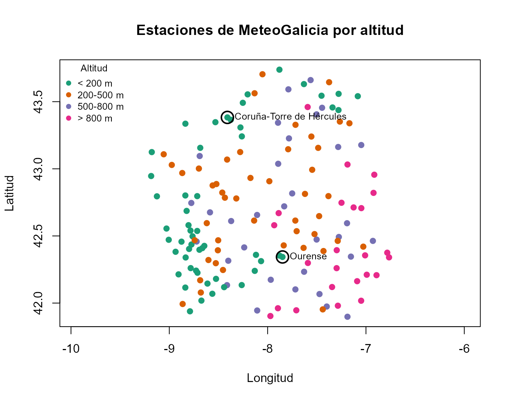
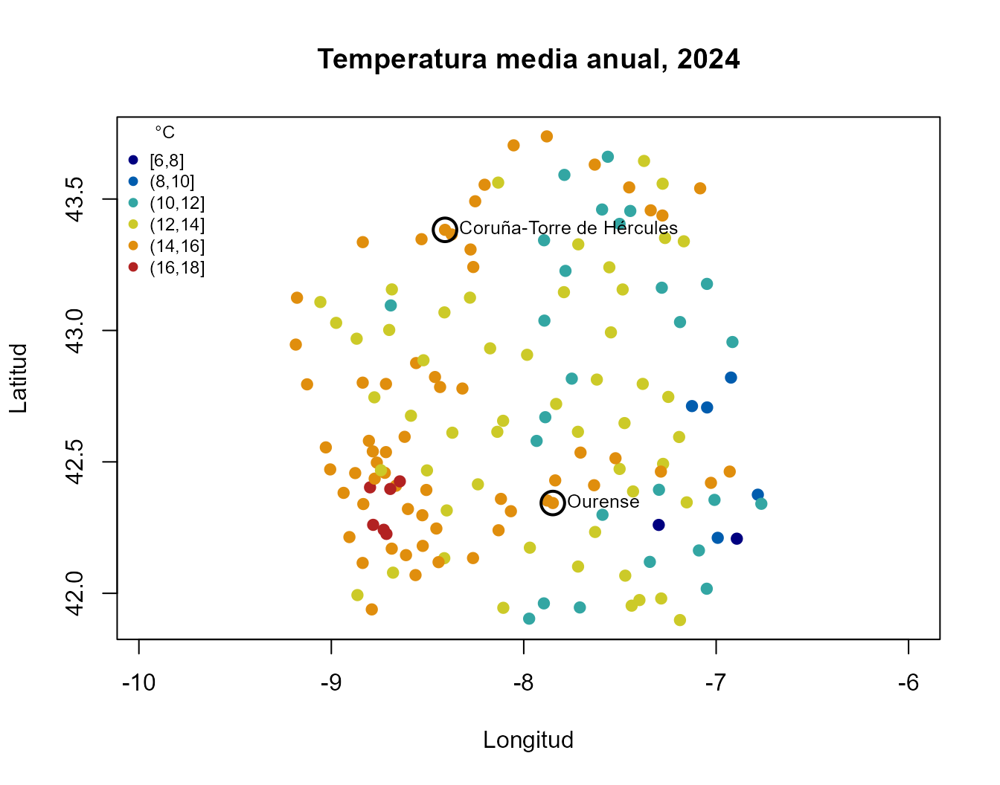
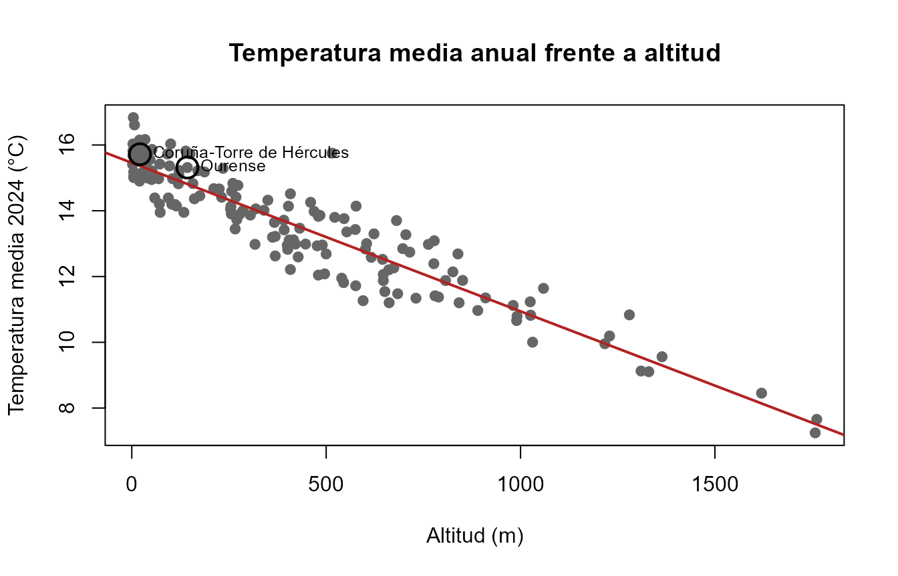
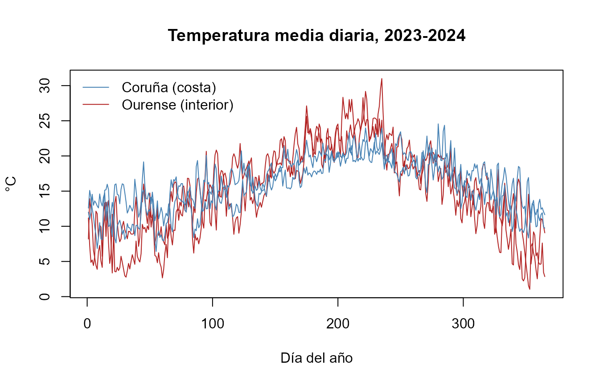
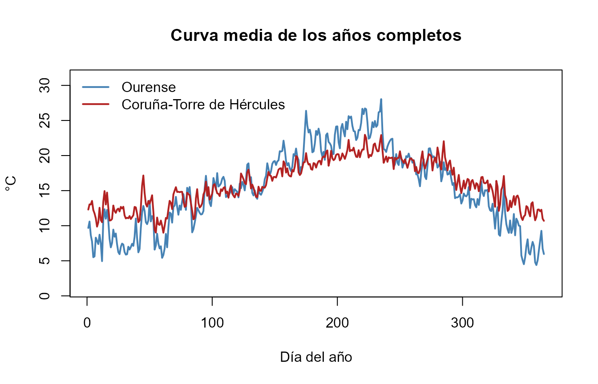

# MeteoGalicia: descarga, exploración espacial y datos funcionales

``` r

library(meteogal2fdata)
library(fda.usc)
#> Warning: package 'MASS' was built under R version 4.6.1
#> Warning: package 'RCurl' was built under R version 4.6.1
#> Warning: package 'nlme' was built under R version 4.6.1
#> Warning: package 'knitr' was built under R version 4.6.1
```

## Objetivo y flujo de trabajo

Esta viñeta recorre el flujo completo del paquete con datos reales de
dos estaciones con climas distintos: **Coruña-Torre de Hércules**
(`10157`, en la costa atlántica) y **Ourense** (`10148`, en el interior,
valle del Miño).

| Paso | Función | Resultado |
|----|----|----|
| 1\. Estaciones | [`meteogal2inventory()`](https://moviedo5.github.io/meteogal2fdata/reference/meteogal2inventory.md) | `data.frame` con identificador, nombre, concello, provincia, altitud, longitud y latitud |
| 2\. Descarga | [`meteogal2download()`](https://moviedo5.github.io/meteogal2fdata/reference/meteogal2download.md) | un fichero por estación y año con valores **sin filtrar** y sus códigos de validación |
| 3\. Lectura | [`meteogal2df()`](https://moviedo5.github.io/meteogal2fdata/reference/meteogal2df.md) | `data.frame` diario; el argumento `quality` decide qué valores se usan |
| 4\. Datos funcionales | [`meteogal2fdata()`](https://moviedo5.github.io/meteogal2fdata/reference/meteogal2fdata.md), [`meteogal2lfdata()`](https://moviedo5.github.io/meteogal2fdata/reference/meteogal2lfdata.md) | objetos `fdata` y `ldata` de `fda.usc`, una curva por estación y año |

Los nombres de las variables y las descripciones de los códigos están en
inglés (`temp_mean`, `prec`, `"Valid original"`, …), igual en todo el
paquete. Los datos de los ejemplos se generan con
`data-raw/build-example.R`; la viñeta no hace consultas a MeteoGalicia
al construirse.

## 1. Estaciones

[`meteogal2inventory()`](https://moviedo5.github.io/meteogal2fdata/reference/meteogal2inventory.md)
consulta el servicio de MeteoGalicia que lista las estaciones **en
funcionamiento**. Para estaciones ya cerradas, el inventario puede
reconstruirse a partir de ficheros descargados con
`meteogal2inventory(data_dir = ...)`.

``` r

inv <- meteogal2inventory(file = "meteogal_inventory.rds")
```

``` r

if (nzchar(fin)) {
  inv <- read.csv(fin, colClasses = c(station_id = "character"), encoding = "UTF-8")
  print(nrow(inv))
  print(table(inv$province))
  print(inv[inv$station_id %in% ejemplo, c("station_id", "station_name", "municipality",
                                          "province", "altitude", "lon", "lat")])
}
#> [1] 155
#> 
#>   A Coruña       Lugo    Ourense Pontevedra 
#>         36         42         34         43 
#>    station_id             station_name municipality province altitude       lon
#> 74      10148                  Ourense      OURENSE  Ourense      143 -7.848846
#> 79      10157 Coruña-Torre de Hércules     A CORUÑA A Coruña       21 -8.409202
#>         lat
#> 74 42.34349
#> 79 43.38276
```

### Mapa por altitud

Longitud y latitud son columnas numéricas, así que basta con
[`plot()`](https://rdrr.io/r/graphics/plot.default.html). La relación de
aspecto `1 / cos(43 * pi / 180)` corrige la deformación horizontal de
representar grados a la latitud de Galicia. Las dos estaciones del
ejemplo se marcan con un círculo.

``` r

if (nzchar(fin)) {
  ok  <- is.finite(inv$lon) & is.finite(inv$lat) & is.finite(inv$altitude)
  alt <- cut(inv$altitude, c(-Inf, 200, 500, 800, Inf),
             labels = c("< 200 m", "200-500 m", "500-800 m", "> 800 m"))
  pal <- c("#1b9e77", "#d95f02", "#7570b3", "#e7298a")
  plot(inv$lon[ok], inv$lat[ok], pch = 19, col = pal[alt[ok]],
       asp = 1 / cos(43 * pi / 180), xlab = "Longitud", ylab = "Latitud",
       main = "Estaciones de MeteoGalicia por altitud")
  ex <- inv$station_id %in% ejemplo
  points(inv$lon[ex], inv$lat[ex], cex = 2.2, lwd = 2)
  if (any(ex)) text(inv$lon[ex], inv$lat[ex], inv$station_name[ex], pos = 4, cex = 0.8)
  legend("topleft", legend = levels(alt), col = pal, pch = 19,
         bty = "n", cex = 0.8, title = "Altitud")
}
```



## 2. Descarga

``` r

log <- meteogal2download(
  start_date  = "2023-01-01",
  end_date    = "2024-12-31",
  station_ids = c("10157", "10148"),
  vars        = c("temp_mean", "temp_min", "temp_max", "hum_mean", "prec"),
  format      = "csv",               # o "rds" (por defecto)
  out_dir     = "meteogal_daily"
)
log
```

Qué hace la descarga:

- Pide los datos al servicio diario en JSON por **meses naturales**, con
  reintentos y pausas. Cada mes descargado se guarda en una caché
  (`_tmp_qc/`), de modo que si la descarga se interrumpe, al repetir la
  misma orden solo se piden los meses que faltan.
- Escribe un fichero por estación y año:
  `meteogal_daily/10157/10157_2024.csv`. Cada variable va acompañada de
  su código: `temp_mean` y `qc_temp_mean`, `prec` y `qc_prec`, etc.
- **No filtra nada**: los valores sospechosos, sin validar o erróneos se
  guardan tal como llegan, con su código. La decisión de qué usar se
  toma al leer (sección 3).
- Añade una fila por fichero escrito a
  `meteogal_daily/_meteogal_manifest.csv` (parámetros pedidos, si hay
  códigos, `quality_filter = none`, fecha y hora UTC, dirección del
  servicio y versión del paquete). Así queda constancia de cómo se
  obtuvo cada fichero.

``` r

read.csv("meteogal_daily/_meteogal_manifest.csv")
```

## 3. Códigos de validación, datos no fiables y datos faltantes

MeteoGalicia asigna a **cada valor** (no a cada día) un código
`lnCodigoValidacion`. La temperatura y la precipitación del mismo día
pueden tener códigos distintos.

``` r

meteogal_qc_codes()
#>   code        description default usable
#> 1    0      Not validated   FALSE   TRUE
#> 2    1     Valid original    TRUE   TRUE
#> 3    2            Suspect   FALSE   TRUE
#> 4    3          Erroneous   FALSE  FALSE
#> 5    5 Valid interpolated    TRUE   TRUE
#> 6    9       Not recorded   FALSE  FALSE
```

| Código | Significado | Uso con el valor por defecto `quality = c(1, 5)` |
|----|----|----|
| 0 | sin validar (habitual en los días más recientes) | `NA` |
| 1 | válido original | se usa |
| 2 | sospechoso | `NA` |
| 3 | erróneo | siempre `NA` |
| 5 | válido, interpolado por MeteoGalicia | se usa |
| 9 | no registrado | siempre `NA` |

Los códigos en el ejemplo real:

``` r

if (nzchar(f)) {
  raw <- meteogal2df(data_dir = f, quality = NULL)   # todo salvo 3 y 9
  raw$year <- format(raw$fecha, "%Y")
  print(table(station = raw$station_id, year = raw$year,
              qc_temp_mean = raw$qc_temp_mean, useNA = "ifany"))
  print(table(station = raw$station_id, qc_prec = raw$qc_prec, useNA = "ifany"))
}
#> , , qc_temp_mean = 1
#> 
#>        year
#> station 2023 2024
#>   10148  365  366
#>   10157  365  366
#> 
#>        qc_prec
#> station   1   2   5
#>   10148 730   1   0
#>   10157 723   0   8
```

El criterio se elige **al leer** y se puede cambiar sin volver a
descargar. Cuando se descartan valores, un mensaje indica cuántos y con
qué código; el código original se conserva siempre en la columna `qc_`.

``` r

if (nzchar(f)) {
  q15  <- meteogal2df(data_dir = f, vars = "prec")                    # c(1, 5)
  q1   <- meteogal2df(data_dir = f, vars = "prec", quality = 1)       # solo originales
  qall <- meteogal2df(data_dir = f, vars = "prec", quality = NULL)    # todo salvo 3 y 9
  c(`c(1, 5)` = sum(is.na(q15$prec)), `1` = sum(is.na(q1$prec)),
    `NULL` = sum(is.na(qall$prec)))
}
#> [MeteoGalicia] quality = c(1, 5): values set to NA: 1 with code 2 (Suspect). Codes are kept in the qc_ columns; see meteogal_qc_codes().
#> [MeteoGalicia] quality = c(1): values set to NA: 1 with code 2 (Suspect); 8 with code 5 (Valid interpolated). Codes are kept in the qc_ columns; see meteogal_qc_codes().
#> c(1, 5)       1    NULL 
#>       1       9       0
```

Para trabajar con datos de los últimos días conviene
`quality = c(0, 1, 5)`, porque MeteoGalicia aún no los ha validado
(código 0).

**Datos faltantes.** El paquete no imputa, interpola ni suaviza nada:

- un día que el servicio no devuelve no aparece en el `data.frame`
  diario (no se inventan filas);
- los valores `-9999` (“sin dato”), los códigos 3 y 9 y los valores
  excluidos por `quality` son `NA`;
- en las curvas, los días ausentes y los `NA` son puntos `NA` de la
  rejilla de 365 días (sección 5).

Los únicos valores interpolados son los que MeteoGalicia marca con
código 5.

## 4. Mapa por temperatura

La altitud es un dato fijo de la estación; una variable meteorológica,
en cambio, hay que resumirla en un periodo y con un criterio de calidad.
`data-raw/build-example.R` descarga la temperatura media diaria de 2024
de toda la red y calcula, por estación, la media anual de los valores
con `quality = c(1, 5)` y el número de días utilizados
(`n_temp_mean_2024`). Para que las medias sean comparables, solo se
representan las estaciones con al menos 330 días.

``` r

if (nzchar(ft)) {
  tm <- read.csv(ft, colClasses = c(station_id = "character"), encoding = "UTF-8")
  ok <- is.finite(tm$lon) & is.finite(tm$lat) & is.finite(tm$temp_mean_2024) &
        tm$n_temp_mean_2024 >= 330
  cat(sum(ok), "estaciones con al menos 330 días de", nrow(tm), "\n")
  br  <- pretty(range(tm$temp_mean_2024[ok]), n = 6)
  grp <- cut(tm$temp_mean_2024, br, include.lowest = TRUE)
  pal <- colorRampPalette(c("navy", "deepskyblue3", "gold", "firebrick"))(nlevels(grp))
  plot(tm$lon[ok], tm$lat[ok], pch = 19, col = pal[grp[ok]],
       asp = 1 / cos(43 * pi / 180), xlab = "Longitud", ylab = "Latitud",
       main = "Temperatura media anual, 2024")
  ex <- ok & tm$station_id %in% ejemplo
  points(tm$lon[ex], tm$lat[ex], cex = 2.2, lwd = 2)
  if (any(ex)) text(tm$lon[ex], tm$lat[ex], tm$station_name[ex], pos = 4, cex = 0.8)
  legend("topleft", legend = levels(grp), col = pal, pch = 19,
         bty = "n", cex = 0.75, title = "°C")
} else {
  cat("Ejecuta data-raw/build-example.R para generar los datos del mapa.\n")
}
#> 153 estaciones con al menos 330 días de 168
```



Cada punto es la media de una estación; no es una superficie
interpolada. Buena parte de la variación se explica por la altitud:

``` r

if (nzchar(ft)) {
  plot(tm$altitude[ok], tm$temp_mean_2024[ok], pch = 19, col = "grey40",
       xlab = "Altitud (m)", ylab = "Temperatura media 2024 (°C)",
       main = "Temperatura media anual frente a altitud")
  fit <- lm(temp_mean_2024 ~ altitude, data = tm[ok, ])
  abline(fit, col = "firebrick", lwd = 2)
  points(tm$altitude[ex], tm$temp_mean_2024[ex], cex = 2.2, lwd = 2)
  if (any(ex)) text(tm$altitude[ex], tm$temp_mean_2024[ex], tm$station_name[ex], pos = 4, cex = 0.8)
  cat("Pendiente:", round(100 * coef(fit)[2], 2), "°C por cada 100 m\n")
}
```



    #> Pendiente: -0.45 °C por cada 100 m

## 5. Una variable como datos funcionales: `fdata`

[`meteogal2fdata()`](https://moviedo5.github.io/meteogal2fdata/reference/meteogal2fdata.md)
convierte una variable en un objeto `fdata`: **una fila por estación y
año** (nombre `estacion_año`, p. ej. `10157_2024`) y 365 columnas, una
por día. El 29 de febrero se elimina y los días siguientes de los años
bisiestos se desplazan, de modo que el día 60 es siempre el 1 de marzo y
las curvas de todos los años son comparables punto a punto.

``` r

if (nzchar(f)) {
  fd <- meteogal2fdata(file = f, var = "temp_mean")
  print(dim(fd$data))
  print(rownames(fd$data))
  est <- sub("_[0-9]{4}$", "", rownames(fd$data))
  col <- ifelse(est == "10157", "steelblue", "firebrick")
  plot(fd, col = col, lty = 1, main = "Temperatura media diaria, 2023-2024",
       xlab = "Día del año", ylab = "°C")
  legend("topleft", c("Coruña (costa)", "Ourense (interior)"),
         col = c("steelblue", "firebrick"), lty = 1, bty = "n")
}
#> [MeteoGalicia] quality = c(1, 5): values set to NA: 1 with code 2 (Suspect). Codes are kept in the qc_ columns; see meteogal_qc_codes().
#> [1]   4 365
#> [1] "10148_2023" "10148_2024" "10157_2023" "10157_2024"
```



La costa tiene un ciclo anual mucho más suave: inviernos más templados y
veranos más frescos que en el interior.

## 6. Varias variables y metadatos: `ldata`

[`meteogal2lfdata()`](https://moviedo5.github.io/meteogal2fdata/reference/meteogal2lfdata.md)
devuelve un objeto `ldata` de `fda.usc`: un `data.frame` `df` con una
fila por estación y año, y un `fdata` por variable, todos con las mismas
filas y en el mismo orden. Con `inventory` se completan las coordenadas
y la altitud, que el servicio diario no siempre devuelve.

``` r

if (nzchar(f)) {
  ld <- meteogal2lfdata(file = f,
                        vars = c("temp_mean", "temp_min", "temp_max", "prec"),
                        inventory = if (nzchar(fi)) fi else NULL)
  print(names(ld))
  print(sapply(ld, NROW))
  print(ld$df[, c("station_id", "station_name", "year", "altitude",
                  "n_days", "n_temp_mean_valid", "n_temp_mean_interp",
                  "n_temp_mean_masked", "n_temp_mean_missing")])
}
#> [MeteoGalicia] quality = c(1, 5): values set to NA: 1 with code 2 (Suspect). Codes are kept in the qc_ columns; see meteogal_qc_codes().
#> [1] "df"        "temp_mean" "temp_min"  "temp_max"  "prec"     
#>        df temp_mean  temp_min  temp_max      prec 
#>         4         4         4         4         4 
#>            station_id             station_name year altitude n_days
#> 10148_2023      10148                  Ourense 2023      143    365
#> 10148_2024      10148                  Ourense 2024      143    365
#> 10157_2023      10157 Coruña-Torre de Hércules 2023       21    365
#> 10157_2024      10157 Coruña-Torre de Hércules 2024       21    365
#>            n_temp_mean_valid n_temp_mean_interp n_temp_mean_masked
#> 10148_2023               365                  0                  0
#> 10148_2024               365                  0                  0
#> 10157_2023               365                  0                  0
#> 10157_2024               365                  0                  0
#>            n_temp_mean_missing
#> 10148_2023                   0
#> 10148_2024                   0
#> 10157_2023                   0
#> 10157_2024                   0
```

Columnas de `ld$df`:

| Columna | Contenido |
|----|----|
| `station_id`, `station_name`, `municipality`, `province`, `altitude`, `lon`, `lat` | estación |
| `year` | año de la curva |
| `n_days` | días con registro (de cualquier variable) |
| `first_date`, `last_date` | primer y último registro de la curva |
| `fecha` | matriz de 365 columnas con la fecha de cada registro (`NA` = sin registro) |
| `n_<v>_valid` | días cuyo valor se usa en la curva de `<v>` |
| `n_<v>_interp` | de ellos, interpolados por MeteoGalicia (código 5) |
| `n_<v>_masked` | días cuyo valor se ha descartado por `quality` (códigos 0, 2, 3 con el valor por defecto) |
| `n_<v>_missing` | `365 - n_<v>_valid` |
| `qc_<v>` | matriz de 365 columnas con el código de validación de cada día |

Las matrices `fecha` y `qc_<v>` se imprimen resumidas (una línea por
curva) y con [`unclass()`](https://rdrr.io/r/base/class.html) se obtiene
la matriz completa. Al ser columnas de `ld$df`,
[`subset()`](https://rdrr.io/r/base/subset.html) las recorta junto con
las curvas.

``` r

if (nzchar(f)) {
  print(ld$df[, c("fecha", "qc_temp_mean")])
  qc <- unclass(ld$df$qc_temp_mean)
  print(qc[, 1:10])
  # días de 2023 en los que la temperatura de Ourense está interpolada
  k <- "10148_2023"
  if (k %in% rownames(qc)) print(unclass(ld$df$fecha)[k, which(qc[k, ] == 5)])
}
#>                                   fecha qc_temp_mean
#> 10148_2023 2023-01-01..2023-12-31 (365)        1:365
#> 10148_2024 2024-01-01..2024-12-31 (365)        1:365
#> 10157_2023 2023-01-01..2023-12-31 (365)        1:365
#> 10157_2024 2024-01-01..2024-12-31 (365)        1:365
#>            1 2 3 4 5 6 7 8 9 10
#> 10148_2023 1 1 1 1 1 1 1 1 1  1
#> 10148_2024 1 1 1 1 1 1 1 1 1  1
#> 10157_2023 1 1 1 1 1 1 1 1 1  1
#> 10157_2024 1 1 1 1 1 1 1 1 1  1
#> character(0)
```

### Curvas completas y métodos de `fda.usc`

Muchos métodos de `fda.usc` no admiten `NA`. Para ellos hay que
seleccionar curvas completas **en la variable que se analiza**
(`n_days == 365` no basta: puede haber días con registro pero sin esa
variable). Rellenar los huecos es una decisión estadística que el
paquete deja al usuario.

``` r

if (nzchar(f)) {
  comp <- subset(ld, ld$df$n_temp_mean_valid == 365)
  cat(nrow(comp$df), "curvas completas de", nrow(ld$df), "\n")
  print(comp$df[, c("station_id", "year")])
  if (nrow(comp$df) >= 1) {
    grupos <- split(seq_len(nrow(comp$df)), comp$df$station_id)
    cols <- c("steelblue", "firebrick")[seq_along(grupos)]
    medias <- lapply(grupos, function(r) func.mean(comp$temp_mean[r]))
    plot(medias[[1]], col = cols[1], lwd = 2, ylim = range(comp$temp_mean$data),
         main = "Curva media de los años completos", xlab = "Día del año", ylab = "\u00b0C")
    for (k in seq_along(medias)[-1]) lines(medias[[k]], col = cols[k], lwd = 2)
    nombres <- comp$df$station_name[match(names(grupos), comp$df$station_id)]
    legend("topleft", nombres, col = cols, lwd = 2, bty = "n")
  }
}
#> 4 curvas completas de 4 
#>            station_id year
#> 10148_2023      10148 2023
#> 10148_2024      10148 2024
#> 10157_2023      10157 2023
#> 10157_2024      10157 2024
```



## Referencias

- Datos diarios de estaciones (JSON), parámetros y códigos de
  validación:
  <https://www.meteogalicia.gal/datosred/infoweb/meteo/docs/rss/JSON_EstacionsDiarios_es.pdf>
- Lista de estaciones (JSON):
  <https://www.meteogalicia.gal/datosred/infoweb/meteo/docs/rss/JSON_listaEstacionsMeteo_es.pdf>
- Estado actual de estaciones (JSON), `-9999` = sin dato:
  <https://www.meteogalicia.gal/datosred/infoweb/meteo/docs/rss/JSON_estado_actual_es.pdf>
- Aviso legal (uso libre citando la fuente):
  <https://www.meteogalicia.gal/aviso-legal>
- Paquete `meteospain`, del que se tomaron ideas para las viñetas:
  <https://emf-creaf.github.io/meteospain/>

Fuente de los datos: MeteoGalicia, Xunta de Galicia.
