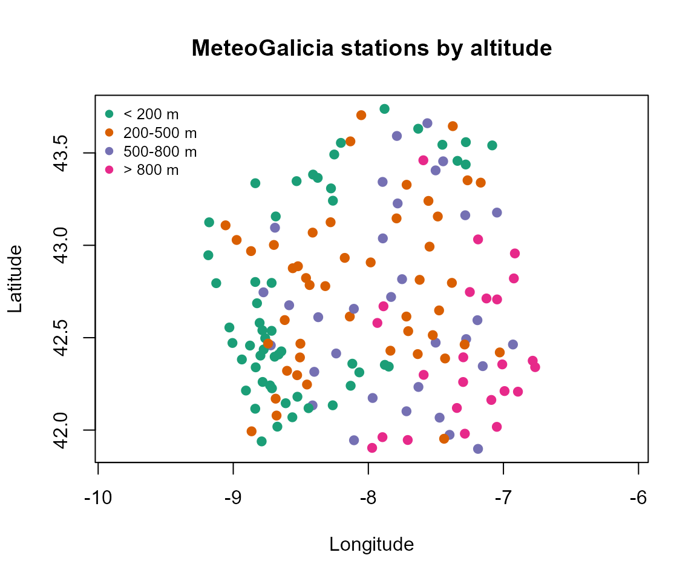
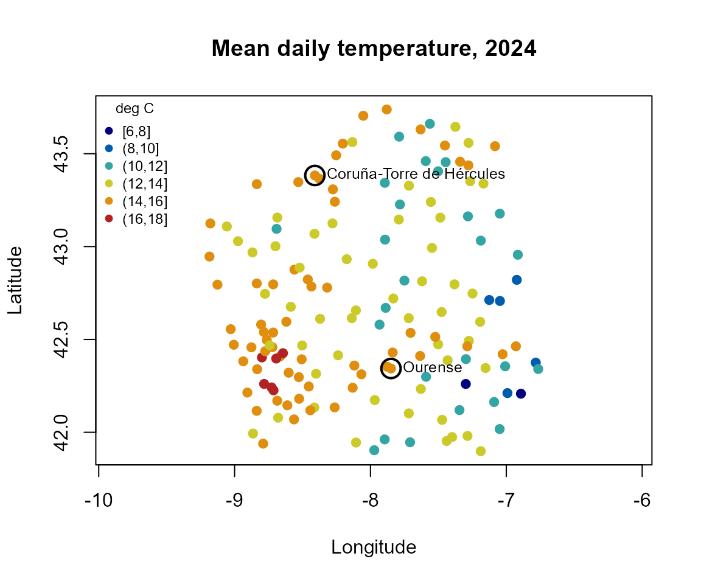
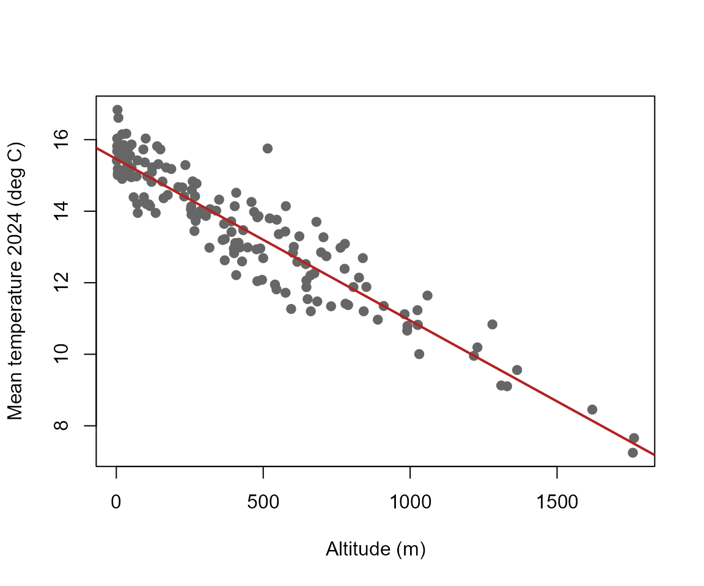

# MeteoGalicia stations: inventory and spatial exploration

``` r

library(meteogal2fdata)
```

## Station inventory

[`meteogal2inventory()`](https://moviedo5.github.io/meteogal2fdata/reference/meteogal2inventory.md)
queries the MeteoGalicia station-list service and returns a base R data
frame with station identifier, name, municipality, province, altitude
and WGS84 longitude/latitude. The online list represents stations
currently in service. An inventory can also be reconstructed from local
downloaded files, which is useful when historical stations are present.

``` r

inv <- meteogal2inventory(file = "meteogal_inventory.rds")
head(inv)
```

For the following offline examples, the package uses the inventory
generated by `data-raw/build-example.R` when it is available.

``` r

p <- system.file("extdata", "meteogal_inventory.csv", package = "meteogal2fdata")
if (nzchar(p)) {
  inv <- read.csv(p, colClasses = c(station_id = "character"), encoding = "UTF-8")
} else {
  inv <- meteogal2inventory(
    data_dir = system.file("extdata", "meteogal_small.csv", package = "meteogal2fdata")
  )
}
head(inv)
#>   station_id   station_name      municipality province altitude       lon
#> 1      10045      Mabegondo          ABEGONDO A Coruña       94 -8.262225
#> 2      10046 Marco da Curra           MONFERO A Coruña      651 -7.894400
#> 3      10047   Pedro Murias           RIBADEO     Lugo       51 -7.083024
#> 4      10048 O Invernadeiro VILARIÑO DE CONSO  Ourense     1026 -7.344628
#> 5      10049      Corrubedo           RIBEIRA A Coruña       30 -9.028601
#> 6      10050     CIS Ferrol            FERROL A Coruña       37 -8.252274
#>        lat first_date last_date
#> 1 43.24137         NA        NA
#> 2 43.34308         NA        NA
#> 3 43.54071         NA        NA
#> 4 42.11956         NA        NA
#> 5 42.55516         NA        NA
#> 6 43.49147         NA        NA
```

## Spatial distribution and altitude

No spatial package is required for a first view of the network because
longitude and latitude are ordinary numeric columns. More advanced
spatial operations can use `sf` after explicit conversion by the user.

``` r

ok <- is.finite(inv$lon) & is.finite(inv$lat) & is.finite(inv$altitude)
alt <- cut(
  inv$altitude,
  breaks = c(-Inf, 200, 500, 800, Inf),
  labels = c("< 200 m", "200-500 m", "500-800 m", "> 800 m")
)
pal <- c("#1b9e77", "#d95f02", "#7570b3", "#e7298a")
plot(
  inv$lon[ok], inv$lat[ok],
  pch = 19, col = pal[alt[ok]],
  asp = 1 / cos(43 * pi / 180),
  xlab = "Longitude", ylab = "Latitude",
  main = "MeteoGalicia stations by altitude"
)
legend("topleft", legend = levels(alt), col = pal,
       pch = 19, bty = "n", cex = 0.8)
```



The aspect ratio approximately corrects the horizontal distortion caused
by plotting longitude and latitude directly at Galician latitudes.

## Mapping an observed variable: annual mean temperature

Station altitude is fixed metadata. Meteorological variables are
different: they must first be defined over a period and with an explicit
validation criterion. `data-raw/build-example.R` therefore creates a
compact 2024 table using daily mean temperature with
`quality = c(1, 5)`.

``` r

tf <- system.file("extdata", "meteogal_temperature_2024.csv",
                  package = "meteogal2fdata")
if (nzchar(tf)) {
  tm <- read.csv(tf, colClasses = c(station_id = "character"), encoding = "UTF-8")
  # Only stations with at least 330 usable days, so that means are comparable
  ok <- is.finite(tm$lon) & is.finite(tm$lat) & is.finite(tm$temp_mean_2024) &
        tm$n_temp_mean_2024 >= 330
  cat(sum(ok), "of", nrow(tm), "stations with >= 330 usable days\n")

  br <- pretty(range(tm$temp_mean_2024[ok]), n = 6)
  grp <- cut(tm$temp_mean_2024, breaks = br, include.lowest = TRUE)
  pal <- colorRampPalette(c("navy", "deepskyblue3", "gold", "firebrick"))(
    length(levels(grp))
  )

  plot(
    tm$lon[ok], tm$lat[ok],
    pch = 19, col = pal[grp[ok]],
    asp = 1 / cos(43 * pi / 180),
    xlab = "Longitude", ylab = "Latitude",
    main = "Mean daily temperature, 2024"
  )
  ex <- ok & tm$station_id %in% c("10157", "10148")
  points(tm$lon[ex], tm$lat[ex], cex = 2.2, lwd = 2)
  if (any(ex)) text(tm$lon[ex], tm$lat[ex], tm$station_name[ex], pos = 4, cex = 0.8)
  legend("topleft", legend = levels(grp), col = pal,
         pch = 19, bty = "n", cex = 0.75, title = "deg C")
} else {
  cat("Run data-raw/build-example.R to create the 2024 temperature map data.\n")
}
#> 153 of 168 stations with >= 330 usable days
```



The map is descriptive rather than an interpolated temperature surface:
each point is the annual mean of the usable daily values at one station
(circled: the two stations of the functional example). Much of the
spatial variation is explained by altitude:

``` r

if (nzchar(tf)) {
  plot(tm$altitude[ok], tm$temp_mean_2024[ok], pch = 19, col = "grey40",
       xlab = "Altitude (m)", ylab = "Mean temperature 2024 (deg C)")
  fit <- lm(temp_mean_2024 ~ altitude, data = tm[ok, ])
  abline(fit, col = "firebrick", lwd = 2)
  cat("Slope:", round(100 * coef(fit)[2], 2), "deg C per 100 m\n")
}
```



    #> Slope: -0.45 deg C per 100 m

## Two contrasting stations

The real example supplied by `data-raw/build-example.R` uses
Coruña-Torre de Hércules (`10157`) and Ourense (`10148`). This provides
a simple coastal-inland contrast and is more informative than comparing
two nearby stations.

``` r

f <- system.file("extdata", "meteogal_example.csv", package = "meteogal2fdata")
i <- system.file("extdata", "meteogal_example_inventory.rds",
                 package = "meteogal2fdata")
if (nzchar(f)) {
  ld <- meteogal2lfdata(
    file = f,
    vars = "temp_mean",
    quality = c(1, 5),
    inventory = if (nzchar(i)) i else NULL
  )
  print(ld$df[, c("station_id", "station_name", "year", "altitude",
                  "lon", "lat", "n_temp_mean_valid")])
}
#> [MeteoGalicia] quality = c(1, 5): values set to NA: 1 with code 2 (Suspect). Codes are kept in the qc_ columns; see meteogal_qc_codes().
#>            station_id             station_name year altitude       lon      lat
#> 10148_2023      10148                  Ourense 2023      143 -7.848846 42.34349
#> 10148_2024      10148                  Ourense 2024      143 -7.848846 42.34349
#> 10157_2023      10157 Coruña-Torre de Hércules 2023       21 -8.409202 43.38276
#> 10157_2024      10157 Coruña-Torre de Hércules 2024       21 -8.409202 43.38276
#>            n_temp_mean_valid
#> 10148_2023               365
#> 10148_2024               365
#> 10157_2023               365
#> 10157_2024               365
```

## Station metadata in functional data

Passing `inventory` to
[`meteogal2lfdata()`](https://moviedo5.github.io/meteogal2fdata/reference/meteogal2lfdata.md)
completes coordinates and altitude in `ldata$df`, which has one row per
station-year. This is recommended before combining spatial station
information with functional curves.

Data source: MeteoGalicia, Xunta de Galicia. Station-list documentation:
<https://www.meteogalicia.gal/datosred/infoweb/meteo/docs/rss/JSON_listaEstacionsMeteo_es.pdf>.
